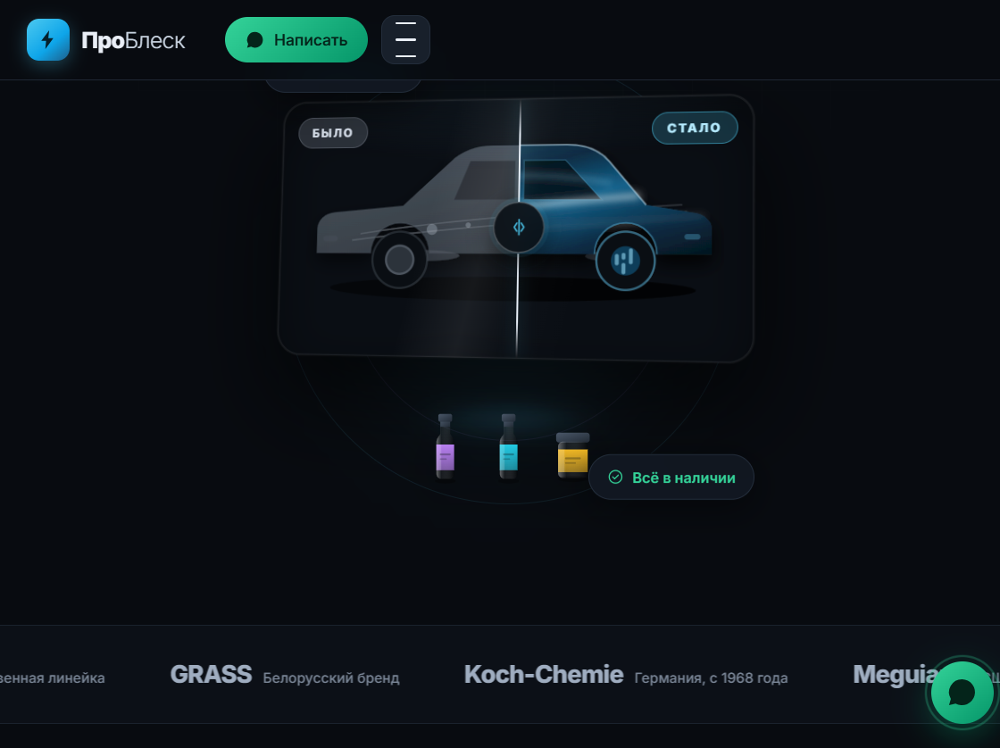
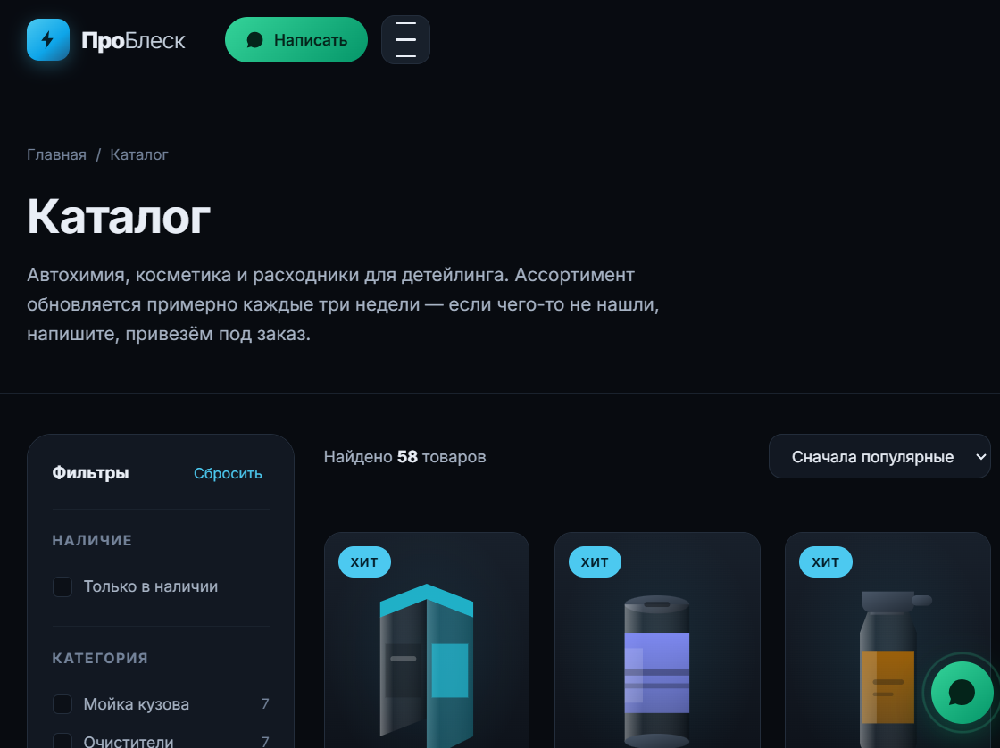
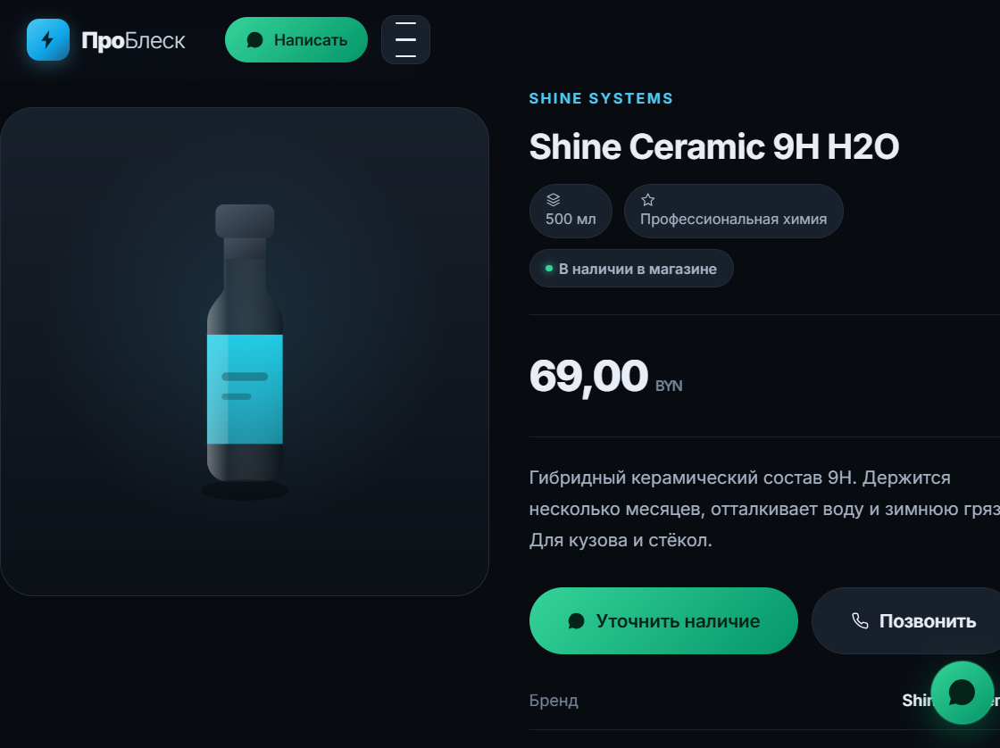
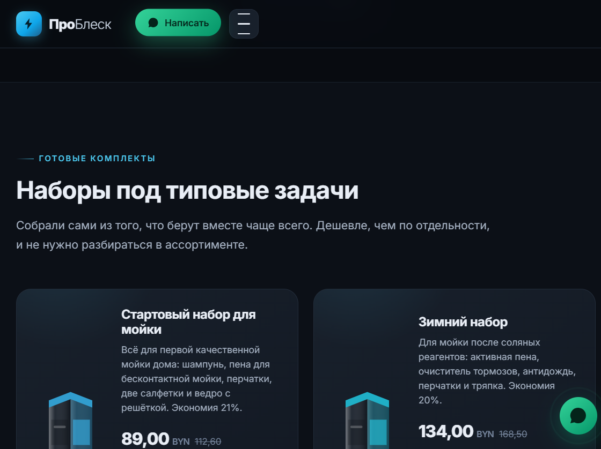
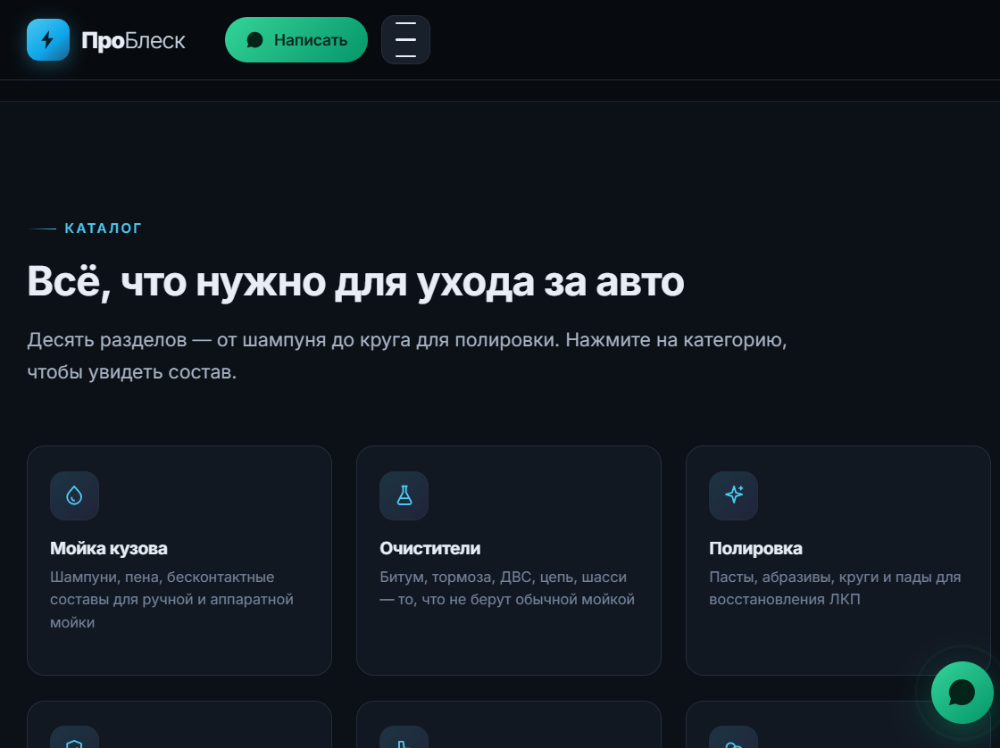
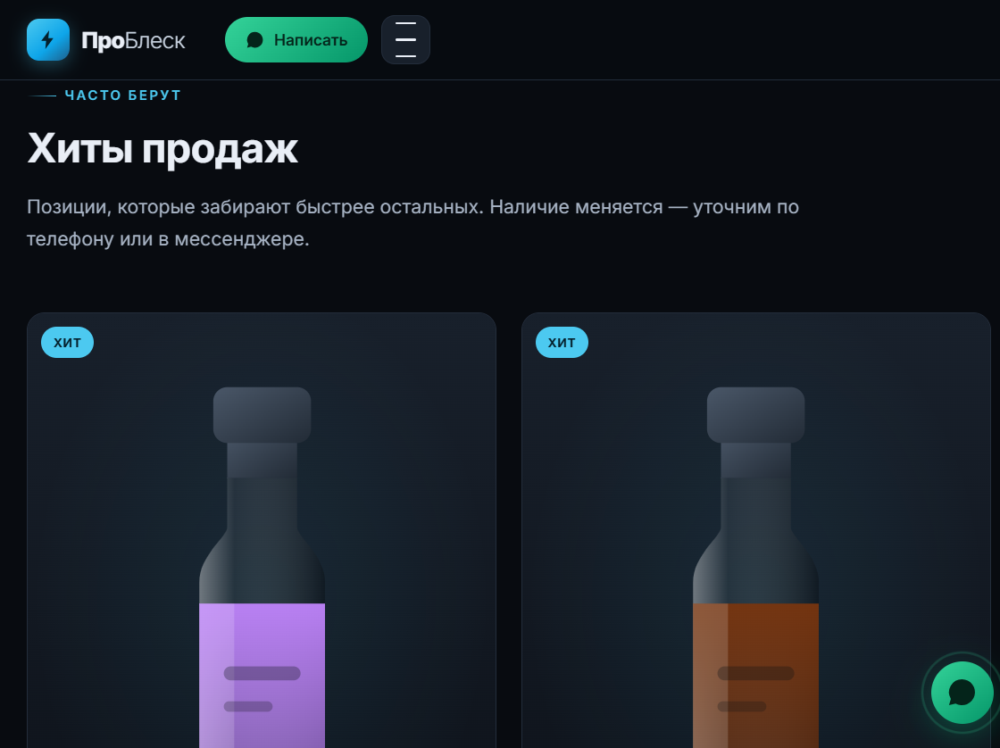

# ПроБлеск — сайт магазина

Прототип сайта магазина автохимии, автокосметики и товаров для детейлинга
**«ПроБлеск»** из Светлогорска. Сделан, чтобы показать владельцу, как будет
выглядеть и работать будущий сайт, и получить согласие до того, как поднимать
WordPress.


**Живая версия:** https://kerarty.github.io/problesk-site/

## Зачем

Магазин уже работает офлайн, но о нём мало кто знает за пределами Светлогорска.
В Instagram и TikTok выходят посты, однако их не находят те, кто специально
ищет «автохимия Светлогорск» — а это как раз готовый клиент.

Сайт решает три задачи:

- показать ассортимент, чтобы человек мог изучить его заранее и не ехать в магазин
  вслепую;
- превратить интерес в заявку — кнопка «Написать» открывает WhatsApp
  с уже подставленным названием товара;
- собрать базу контактов для будущих акций и новостей.

Онлайн-оплаты пока нет намеренно: товар всё равно едет к человеку или ждёт в
магазине. Заявка в мессенджер честнее и для клиента, и для владельца.

## Что умеет

- **Первый экран со сравнением «до и после»** — тот же кузов в двух состояниях,
  граница между ними перетаскивается мышью и пальцем. Показывает результат
  раньше, чем клиент прочитает текст.
- **Лендинг из 13 блоков** — от первого экрана до FAQ, с акцентом на экспертизу:
  четыре типичные проблемы и что с ними делать, блок «помощь в выборе», отзывы.
- **Каталог на 58 позиций** в 11 категориях: мойка, очистители, полировка, защита
  ЛКП, салон, химчистка, пластик, расходники, ароматизация, бытовая химия,
  готовые наборы.
- **Фильтры** по наличию, категории и бренду, плюс сортировка по цене,
  популярности и алфавиту. Выбранные условия показываются «плашками» и снимаются
  по одной.
- **Карточка товара** с описанием на языке результата, характеристиками и кнопкой
  «Уточнить наличие» в WhatsApp.
- **Внутренние страницы**: о магазине, доставка и оплата, контакты с адресом,
  часами работы и ссылками на Яндекс.Карты и 2ГИС.
- **Мобильная вёрстка** — примерно 80% трафика придёт с телефона.
- **Тёмная тема в стиле бренда**: графит, серебро и холодный голубой акцент.

Каждая страница набирает 100/100 в Lighthouse по доступности, SEO и
best practices.

## Скриншоты

Сравнение «до и после» на первом экране — граница тянется мышью и пальцем:



Каталог с фильтрами:



Карточка товара:



Готовые наборы — с экономией против поштучной покупки:



Категории — десять разделов, ведущих прямо в отфильтрованный каталог:



Витрина хитов:



## Запуск

Ничего устанавливать не нужно — ни сборки, ни зависимостей, ни сервера.

Достаточно открыть `index.html` в браузере. Если хочется проверить работу
с локального сервера (так ближе к боевым условиям):

```bash
python -m http.server 8734
```

и открыть `http://127.0.0.1:8734/index.html`.

Единственное, что тянется из интернета, — шрифт Inter с Google Fonts. Без сети
подхватится системный шрифт, ничего не сломается.

## Структура

```
index.html        лендинг
catalog.html      каталог с фильтрами
product.html      карточка товара (?id=...)
about.html        о магазине
delivery.html     доставка и оплата
contacts.html     контакты

assets/css/style.css   дизайн-система и вёрстка
assets/js/data.js      категории, бренды, товары, FAQ — меняемый контент
assets/js/ui.js        иконки, генератор картинок товаров, шапка и подвал
assets/js/main.js      меню, аккордеон, появление блоков, формы
assets/js/home.js      сборка главной
assets/js/catalog.js   фильтры, сортировка, отрисовка каталога
assets/js/product.js   страница товара

PLAN.md           план запуска сайта на WordPress
TASKS.md          чек-лист работ по этапам
```

Чтобы поменять ассортимент или цены, правьте `assets/js/data.js` — остальной
код трогать не нужно.

## Технологии

- HTML5 и семантическая разметка, без фреймворков
- CSS с кастомными свойствами, адаптив на гридах
- Ванильный JavaScript, ES6, без библиотек
- Картинки товаров генерируются кодом (SVG) — витрина выглядит живой, пока нет
  настоящих фото

## Важно

Прототип собран на демонстрационных данных. Реальные цены, состав ассортимента
и фотографии подставятся на этапе переноса в WordPress. Подтверждены по
открытым источникам только бренды **Shine Systems**, **Leraton** и собственная
линейка **ProБлеск** — остальные в `data.js` проставлены как пример.

Контакты в прототипе настоящие: адрес, телефон и режим работы взяты из
публичных источников.

## Планы

Дальше — по [`PLAN.md`](PLAN.md):

1. собрать реальный прайс и фотографии, заменить демо-данные;
2. поднять WordPress + WooCommerce и перенести эту вёрстку в тему;
3. подключить онлайн-оплату и доставку, когда владелец решит, что это нужно;
4. синхронизировать каталог с 1С, если она появится.